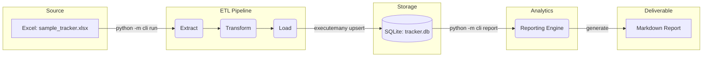

# job-tracker-pipeline




## Design Decisions

### Modular ETL Architecture: 
The pipeline is separated into distinct extract, transform, load, and report modules, decoupling data ingestion from the final reporting logic.

### Robust Salary & Date Parsing: 
The transformation layer normalizes disparate compensation formats (extracting ranges and converting hourly rates to annual salaries based on a 2,080-hour year) and standardizes application status mappings and close dates.

### Dynamic Employer Classification: 
Employer categories are driven by an external employer_types.json configuration file, allowing for easy updates to classification rules without altering the core Python logic.

### Testable Database Operations: 
Database interactions utilize connection injection, enabling the test suite to use in-memory SQLite databases to safely and quickly validate executemany batching and UPSERT logic.

### SQLite Optimization: 
The database connection is configured to use Write-Ahead Logging (WAL) mode to improve concurrent read/write performance.

## Quickstart

### 1. Set up the virtual environment and install dependencies:
```
python -m venv .venv
source .venv/bin/activate  # On Windows use: .venv\Scripts\activate
pip install -r requirements.txt
```

### 2. Run the ETL pipeline:
This will extract data from data/sample_tracker.xlsx, apply transformations, and load the 40 records into tracker.db.
```
python -m src.job_tracker.cli run
```

### 3. Generate the Markdown report:
This queries the database and outputs the final metrics and funnel tables to the reports directory.
```
python -m src.job_tracker.cli report
```

